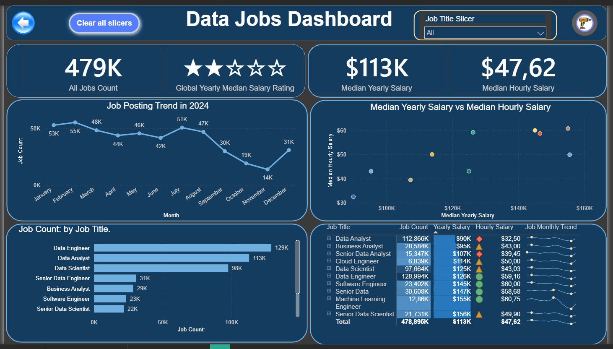
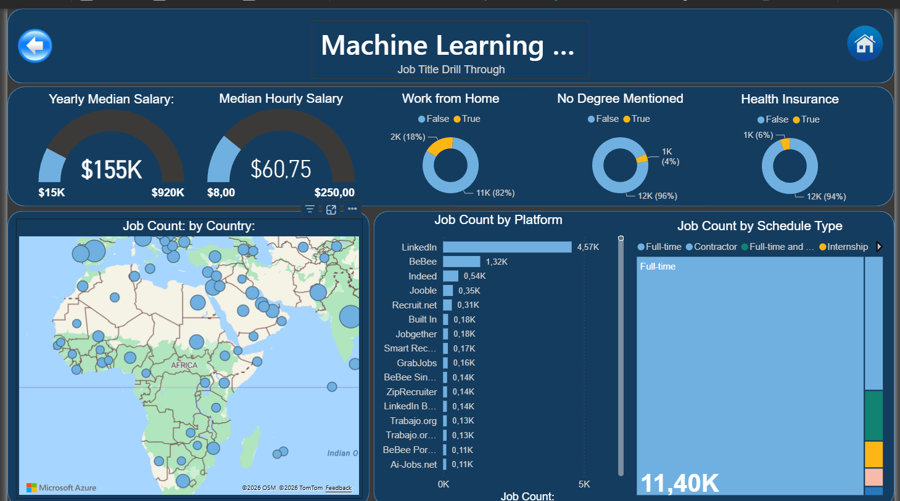

This is a test file

# Data Jobs Dashboard w/ Power BI.

### Description:
- Whether any response has been received from the Department of Home Affairs regarding the Refugee ID application, and if so, what the outcome or indicated timeline is.
- Whether any further documentation or supporting information is required from our side to advance the matter.
- The anticipated next steps and timeframes, including whether next appointment with you is now being considered.

### Drill-through Description:
- Whether any response has been received from the Department of Home Affairs regarding the Refugee ID application, and if so, what the outcome or indicated timeline is.
- Whether any further documentation or supporting information is required from our side to advance the matter.
- The anticipated next steps and timeframes, including whether next appointment with you is now being considered.
[View the interactive on the power BI Service](https://www.jukeb.co/powerbi-project1)
## Introduction:
This dashboard views was designed with  **datajob seekers, job transitioners and job swappers** in mind, to solve a common problem of data overload.
Information about data job market is so scattered and hard to lay fingers on.  Using a *real-world dataset of 2026 data jobs posting*, with details including job titles, average salaries, locations and much more that could be drilled through by a single click.

This project provides one simple easy-to-use solution to both employers, employees and data job seekers.
## Skills showcase:
- I am writing to follow up on the matter of Angel-Bezy Mputu (File Reference:  CTR/000584/07), concerning the outstanding Refugee Identity Document application and the suspension of the social grant payments by SASSA.
## Conclusion:

1.	Whether any response has been received from the Department of Home Affairs regarding the Refugee ID application, and if so, what the outcome or indicated timeline is.
2.	Whether any further documentation or supporting information is required from our side to advance the matter.
3.	The anticipated next steps and timeframes, including whether next appointment with you is now being considered.

Mr. Mputu Angel-Bezy
ML Engineer & Data Analyst

Section 20
11 Hamman Str, Delft/Leiden
7100, South Africa
Email: angelbezy@gmail.com

